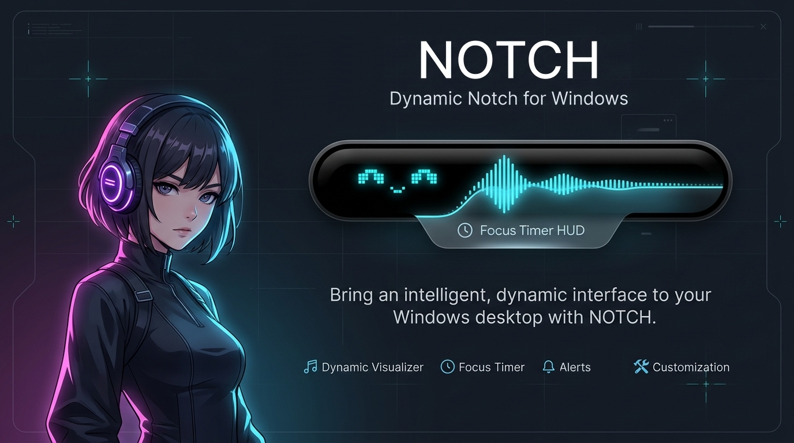
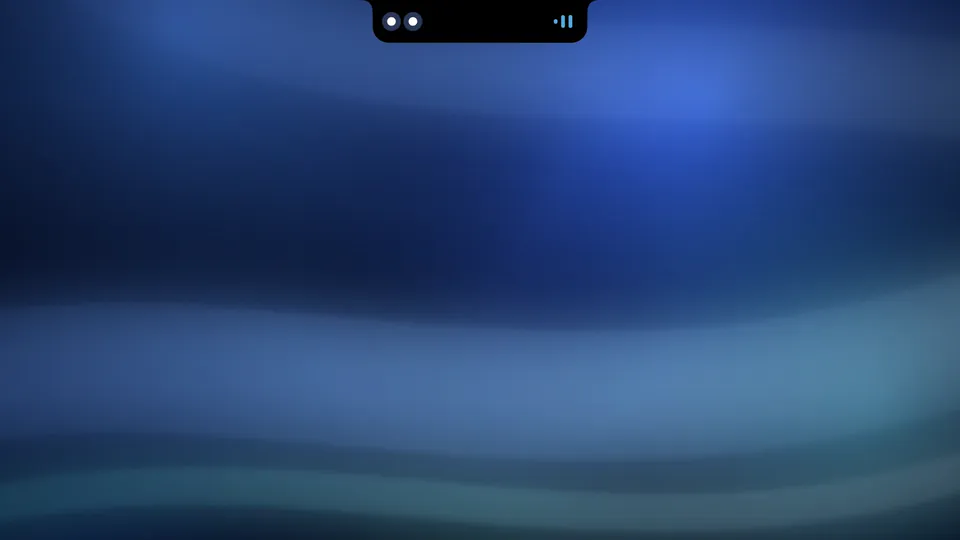
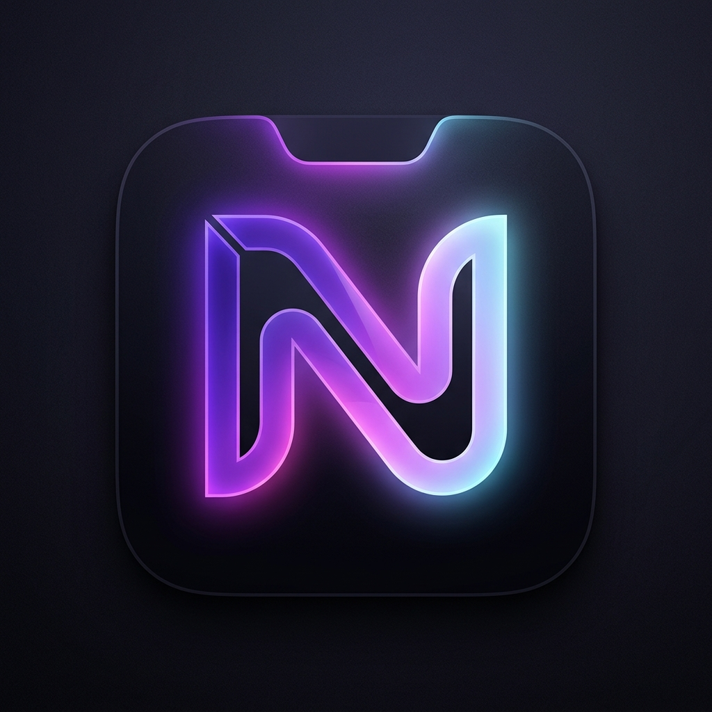

<p align="center">
  
</p>

<h1 align="center">Notch</h1>

<p align="center">
  <a href="https://github.com/KrisnaSantosa15/notch/releases/latest"></a>
  
  
  <a href="https://github.com/microsoft/winget-pkgs/tree/master/manifests/k/KrisnaSantosa15/notch"></a>
</p>

<p align="center">
  <b>MacBook-like Dynamic Island & Notch for Windows 10/11.</b><br>
  Built with native Win32 and tiny-skia in Rust. Zero web engine, ~1.4 MB binary, ~40 MB RAM, and 0% CPU idle.
</p>

---

## Demo

<p align="center">
  <a href="https://youtu.be/evf-Ct_pw5A" target="_blank">
    
  </a>
  <br>
  <sub>Click to watch the full 22-second launch film on YouTube (1080p, with sound).</sub>
</p>

## Features

- **Dynamic Island (Closed Notch)**:
  - **Ambient Media**: Live music visualizer, album art, and synchronized scrolling lyrics.
  - **Focus Timer**: Pomodoro countdown ring with glowing bottom-rim progress.
  - **Satellite Bubble**: Detached island bubble when timer and music run concurrently.
  - **Quick HUD**: Instant volume, Caps Lock, battery status, and hardware privacy dots (camera/mic).
  - **Ambient Underglow**: Soft diffused aurora glow matching album art colors during playback.

- **Interactive Modules (Open Notch)**:
  - **Music**: Track info, playback controls, seekbar, and synchronized line-tap lyrics ([LRCLIB](https://lrclib.net)).
  - **Focus**: Pomodoro countdown (15/25/45/60 min) with live finish estimation and accent color matching.
  - **Shelf**: Staging ground for dragging files onto the notch and retrieving them later.
  - **Tasks**: Quick to-do list with natural time parsing (`Stand-up 09:30`) and overdue alerts.
  - **Settings**: In-app controls for theme accents, tab visibility, system behaviors, and reset to defaults.

- **Engineering**:
  - **Spring Physics**: Critically damped physics without rubbery overshoot.
  - **Specular Rim Highlight**: Optical glass reflection tracking cursor position.
  - **Tactile Audio**: In-memory synthesized sound effects (pop, tick, chime, drop) without external files.
  - **Fullscreen Suppression**: Automatically hides during gaming, fullscreen video, and presentations.

---

## Controls and Shortcuts

| Action | Result |
| :--- | :--- |
| **Hover or Click Notch** | Opens / expands notch |
| **Win + Alt + N** | Toggle open / close globally |
| **Scroll Wheel over Notch** | Adjust system volume (with haptic ticks & header capsule) |
| **Shift + Scroll Wheel** | Seek media forward / backward (+/- 5s) |
| **Drag Files onto Notch** | Expands Shelf to stage files |
| **Right-Click / Tray Icon** | Context menu (Toggle, Autostart, About, Quit) |

---

## Installation

### Via WinGet (Recommended)
```powershell
winget install KrisnaSantosa15.notch
```

### Prebuilt Binary
Download `notch-windows-x86_64.zip` from the [Latest Release](https://github.com/KrisnaSantosa15/notch/releases/latest), extract, and run `notch.exe`.

### Build from Source
```powershell
git clone https://github.com/KrisnaSantosa15/notch.git
cd notch
cargo run --release
```

---

## Configuration

Configure Notch directly from the built-in **Settings** tab. 

For advanced customization, Notch reads `%APPDATA%\Notch\config.toml` (dimensions, auto-close delay, and behavior toggles).

---

## Testing

```powershell
cargo test                 # unit tests
cargo test -- --ignored    # includes live LRCLIB network test
```

---

## License

Licensed under the [GNU Affero General Public License v3.0](LICENSE) (AGPLv3) &copy; 2026 Krisna Santosa.

<p align="center">
  <br>
  Built with precision by <b>Krisna Santosa</b>
</p>
